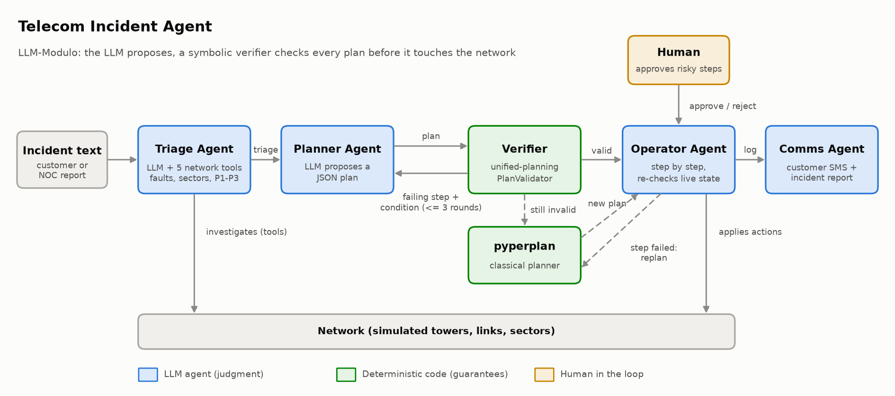
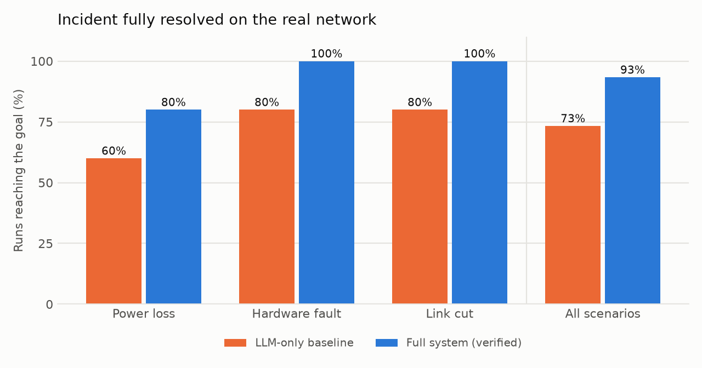
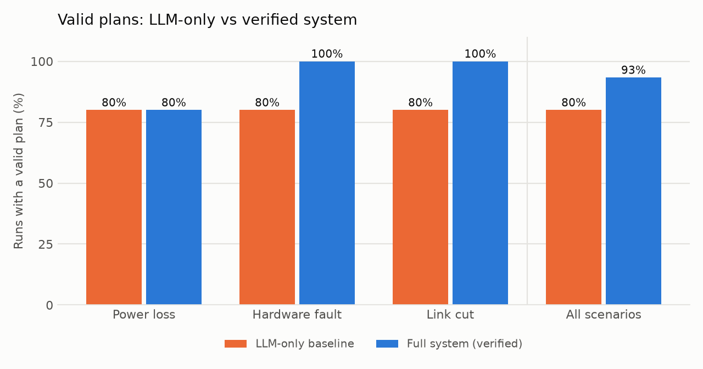
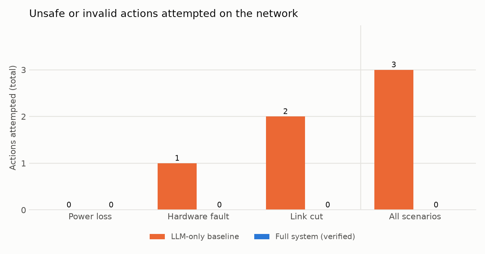

# Telecom Incident Agent

**A multi-agent system for telecom incidents: LLM agents diagnose, act and communicate, and a symbolic verifier checks every plan before it touches the network.**

**Live demo:** https://telecom-incident-agent.streamlit.app/ · **Demo video:** _coming soon_



## The problem

LLM agents are good at reading messy reports and deciding what to do, but in network operations a plausible plan is not enough. A plan that restarts a tower before its power is back, or reroutes traffic to a tower that is itself down, makes an outage worse. An LLM-only agent gives no guarantee that each step's preconditions hold, and it has no way to recover when a step fails mid-run.

## The solution

**Agents for judgment, code for guarantees** (the LLM-Modulo pattern):

1. **Triage Agent** (LLM + tools) reads a customer complaint or NOC report and investigates the network: alarms, diagnostics, affected sectors, priority.
2. **Planner Agent** (LLM) proposes a repair plan as strict JSON.
3. **Verifier** (unified-planning `PlanValidator`) checks every step against a formal domain and returns the exact failing step and condition, for example `step 2: restart_node(T3) needs hw_ok(T3)`. The LLM fixes the plan, up to 3 rounds; if it still fails, **pyperplan** solves the problem directly.
4. **Operator Agent** executes step by step, re-checks preconditions on the live network, pauses for **human approval** on risky actions (`restart_node`, `reroute_traffic`), and **replans** from the live state when a step fails.
5. **Comms Agent** writes customer SMS (no internal ids, at most 160 characters) and an incident report.

The LLM never writes PDDL. It fills JSON schemas; code builds the formal problem, so LLM errors stay contained and measurable. One action spec (`core/spec.py`) drives both the planner and the simulator, so they cannot drift apart.

## Results

20 scenarios (power loss, hardware fault, link cut, multi-fault cascades; 3 with noisy customer text, 4 with a restart failure injected mid-run), 3 runs each. The **baseline** is the same LLM's first plan with no verifier and no replanning; both arms are scored on the true network after execution.

<!-- results:start -->
Model `openai/gpt-oss-20b`, 15 runs over 15 scenarios.

| Metric | LLM-only baseline | Verified system |
| --- | --- | --- |
| Valid plans | 80% | 93% |
| Unsafe or invalid actions attempted | 3 | 0 |
| Incident resolved, no injected failure (13 runs) | 85% | 92% |
| Incident resolved, restart fails mid-run (2 runs) | 0% | 100% |
| Plan length / optimal | 1.23 | 1.21 |

Triage exact match 93%; LLM plans fixed after verifier feedback 13%; pyperplan fallback 0%.



| Valid plans | Unsafe or invalid actions |
| --- | --- |
|  |  |
<!-- results:end -->

Full numbers: [eval/summary.md](eval/summary.md) · raw runs: `eval/results.jsonl`

## Run locally

```bash
git clone https://github.com/DathaNallagonda/telecom-incident-agent.git && cd telecom-incident-agent
python -m venv .venv && .venv\Scripts\activate      # macOS/Linux: source .venv/bin/activate
pip install -r requirements-dev.txt
copy .env.example .env                               # macOS/Linux: cp; then add GROQ_API_KEY (and optionally GEMINI_API_KEY)
streamlit run app.py
```

Tests: `pytest` · Benchmark: `python -m eval.run_eval` then `python -m eval.summarize`

Free API keys: [Groq](https://console.groq.com) (main) and [Google AI Studio](https://aistudio.google.com) (backup). The app tries Groq gpt-oss-120b, then gpt-oss-20b, then Gemini; each has its own free-tier quota.

## Project structure

```
app.py                  Streamlit UI (run an incident, Benchmark, How it works)
core/
  spec.py               the planning domain: one action spec for planner and simulator
  simulator.py          simulated network: state, actions, failure injection
  domain.py             unified-planning domain built from the spec
  problem_builder.py    network state + triage belief -> planning problem
  planner.py            pyperplan solve() and PlanValidator validate()
  llm.py                model chain, disk cache, call log
agents/
  triage.py             Triage Agent (ReAct + network tools)
  planner_agent.py      verify-and-fix loop (LLM-Modulo) and the LLM-only baseline
  operator.py           execution, approvals, replanning
  comms.py              customer SMS and incident report
  graph.py              LangGraph supervisor with interrupt() for approvals
eval/
  make_scenarios.py     builds scenarios.json (optimal lengths from pyperplan)
  run_eval.py           resumable benchmark harness
  summarize.py          summary.md, charts, this README's results
tests/                  pytest suite; LLMs replaced by scripted fakes
```

## Tech stack

Python 3.11 · LangGraph · LangChain (Groq, Google GenAI) · unified-planning + pyperplan · Pydantic · networkx · Streamlit · matplotlib · pytest. Everything runs on free tiers.

## Limitations

- Hand-written planning domain (9 actions) and a simulated network of 7 nodes and 6 sectors.
- 20 scenarios; one strong model writes few invalid plans on them, so the verifier's direct effect is small there (see the model comparison in [eval/summary.md](eval/summary.md)).
- Free-tier rate limits make the live demo slow or unavailable at times.

## Future work

- HTN runbooks for common incident types; plan only over the affected subgraph to scale to thousands of nodes.
- OR-Tools scheduling for technician dispatch.
- Real telemetry and alarm feeds instead of the simulator.
- Deployment on Azure (Container Apps, Azure OpenAI, Key Vault, Application Insights).

## Background

Kambhampati et al., *LLMs Can't Plan, But Can Help Planning in LLM-Modulo Frameworks* (2024); Liu et al., *LLM+P* (2023).

## License

MIT
