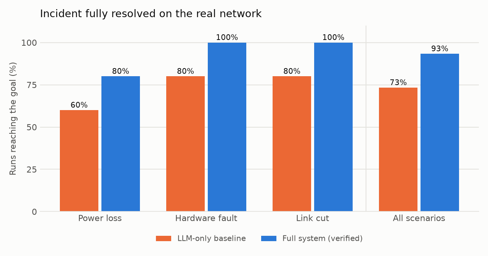
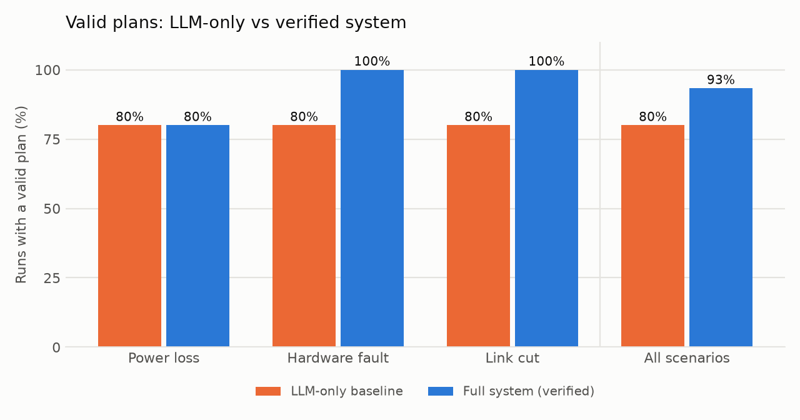
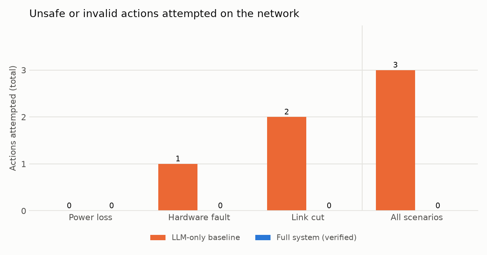

# Evaluation summary

15 runs over 15 scenarios; model `openai/gpt-oss-20b`; goal reached is checked on the true network after execution.

**Headline:** incidents fully resolved 93% (system) vs 73% (LLM-only baseline); valid plans 93% vs 80%; unsafe or invalid actions attempted: 0 vs 3.

| Metric | Baseline | System |
| --- | --- | --- |
| Valid-plan rate | 80% | 93% |
| Goal reached after execution | 73% | 93% |
| ...without injected failures (13 runs) | 85% | 92% |
| ...with an injected restart failure (2 runs) | 0% | 100% |
| Unsafe or invalid actions attempted (total) | 3 | 0 |
| Runs with any unsafe or invalid action | 13% | 0% |
| Plan length / optimal | 1.23 | 1.21 |
| Latency per incident (s) | — (shares the first call) | 18.82 |

| System-only metric | Value |
| --- | --- |
| Triage exact match | 93% |
| Triage fault accuracy / sector accuracy | 0.93 / 0.93 |
| Average LLM plan rounds | 1.14 |
| LLM plan fixed after verifier feedback | 13% |
| Planner fallback rate | 0% |
| Replan recovery rate | 100% of 2 runs |

## By scenario type

| Type | Runs | Valid plans (base / sys) | Goal reached (base / sys) | Unsafe attempts (base / sys) |
| --- | --- | --- | --- | --- |
| Power loss | 5 | 80% / 80% | 60% / 80% | 0 / 0 |
| Hardware fault | 5 | 80% / 100% | 80% / 100% | 1 / 0 |
| Link cut | 5 | 80% / 100% | 80% / 100% | 2 / 0 |

## How to read this

- The baseline has no verifier and no replanning, by design. In the 4 scenarios with an injected restart failure it cannot recover, so most of the goal-reached gap measures replanning, not plan quality.
- The verifier's direct effect shows in valid plans and unsafe actions: an LLM plan that breaks a precondition is fixed before it runs (system) or runs as-is (baseline).
- The system plans from what triage believes. When triage misses an affected sector, the first plan misses it too; only a replan from the live network recovers it.
- One model (Groq gpt-oss-120b) for both arms; temperature 0; cache off so each run is a fresh sample.

